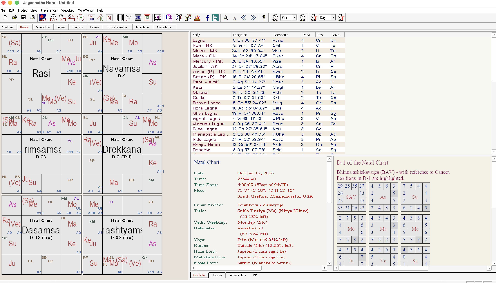

# Jagannatha Hora 8.0 for macOS

> **Unofficial package.** Jagannatha Hora is freeware by **P.V.R. Narasimha Rao**
> ([vedicastrologer.org](https://www.vedicastrologer.org/jh/index.htm)).
> This macOS package is a community effort and is shared with the author for his review and approval.
> It is not affiliated with or endorsed by him. If he asks for it to be withdrawn, it will be.

This package lets you run the original, unmodified **Jagannatha Hora 8.0** on a Mac as a normal,
double-clickable application. It is **not a rewrite**: it bundles the official program files,
ephemeris, atlas and fonts with [Wine](https://www.winehq.org), the open-source compatibility layer
that runs Windows programs on macOS. All calculations are exactly those of the Windows version.



## Download

**[⬇ Download JagannathaHora-8.0-mac.dmg](https://github.com/naveenkumarreddym/jhora-mac/releases/latest)** (about 430 MB)

SHA-256: `96e71bb23a2b509baa0b909ba5b780f2d4950b70514ac51cde1116bd9bf06aaf`

## Requirements

- macOS 11 (Big Sur) or later
- Intel or Apple Silicon Mac (Apple Silicon needs [Rosetta 2](https://support.apple.com/en-us/102527); the app tells you if it is missing)
- About 1.5 GB of free disk space

## Install

1. Open the `.dmg` and drag **Jagannatha Hora** onto the **Applications** folder.
2. Double-click **Jagannatha Hora**. macOS will warn that it is from an unidentified developer,
   because the package is not signed with an Apple Developer ID. Click **Done**.
3. Open **System Settings → Privacy & Security**, scroll down, click **Open Anyway** next to
   Jagannatha Hora, and confirm.
4. The first launch takes about a minute while it sets itself up. Later launches open straight into JHora.

**To quit,** use **File → Exit** inside JHora.

## Where your data lives

| What | Location |
| --- | --- |
| Saved charts (`.jhd`) | `~/Library/Application Support/JHora/prefix/drive_c/JHora/data` |
| Log file | `~/Library/Logs/JHora.log` |

**To uninstall,** delete the app and the folder `~/Library/Application Support/JHora`.

## Known limitations

- The interface looks like Windows, not like a native Mac app.
- First launch shows the "unidentified developer" warning (see Install, step 2).
- Double-clicking a `.jhd` file in Finder does not open it; use **File → Open** inside JHora.
- Tested so far on macOS 26 on Apple Silicon. Reports from other Macs are welcome via
  [Issues](https://github.com/naveenkumarreddym/jhora-mac/issues).

## How it is built

The app contains:

- `Contents/Resources/wine/` – [Wine Staging 11.17](https://github.com/Gcenx/macOS_Wine_builds/releases/tag/11.17) for macOS
- `Contents/Resources/payload/` – JHora 8.0 files and Indic fonts, extracted unchanged from the official
  `jh_full_install.exe` (SHA-256 `37df1209d11d646d665577c515afbb2252d31cdcca8b46494e2dbd785dcda4c2`),
  plus [`jhora.reg`](packaging/jhora.reg) (font registration and settings the Windows installer would create)
- `Contents/MacOS/JHora` – a small [launcher script](packaging/JHora) that creates a private Wine
  environment on first run and then starts `jhora.exe`

To rebuild it yourself from the official installer (requires [Homebrew](https://brew.sh)):

```bash
./build.sh /path/to/jh_full_install.exe
# output: dist/JagannathaHora-8.0-mac.dmg
```

## Credits and licences

- **Jagannatha Hora** © P.V.R. Narasimha Rao. Freeware; all rights remain with the author.
  This repository contains only packaging scripts; the program itself is only in the release download.
- **Wine** is licensed under the [LGPL 2.1](https://gitlab.winehq.org/wine/wine/-/blob/master/LICENSE).
  The macOS build is by [Gcenx](https://github.com/Gcenx/macOS_Wine_builds); source is at
  [winehq.org](https://www.winehq.org).
- **Swiss Ephemeris** (included with JHora) is by Astrodienst AG.

The packaging scripts in this repository are released under the MIT licence.
